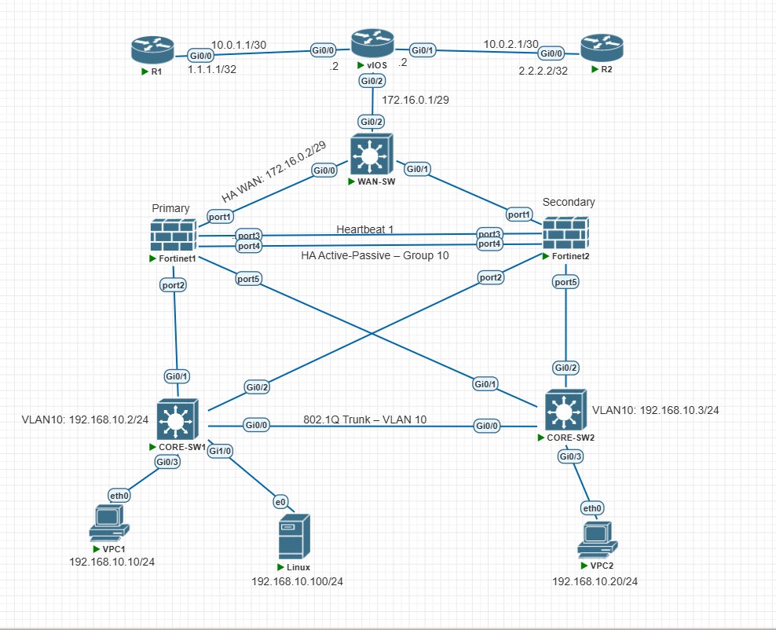

# FortiGate High Availability Network Lab | PNETLab

**Personal network engineering lab** · Cisco IOS · FortiOS 7.2 · PNETLab

## Overview

Designed and tested a simulated enterprise LAN/WAN network integrating Cisco routers and switches with a two-node **FortiGate Active-Passive HA (FGCP)** cluster. The lab focuses on L2 switching, IPv4 static routing, firewall traffic control, end-to-end reachability, and firewall failover/recovery.

> **Scope:** This repository documents a virtual lab, not a production deployment. OSPF, BGP, DHCP, SD-WAN and IPS were **not** implemented in this version.

## Network topology

| Component | Configuration |
|---|---|
| Edge routers | R1 loopback `1.1.1.1/32`, R2 loopback `2.2.2.2/32` |
| Transit links | `10.0.1.0/30` and `10.0.2.0/30` |
| WAN segment | `172.16.0.0/29`; edge gateway `172.16.0.1`, FortiGate `172.16.0.2` |
| WAN switch | VLAN 100 |
| FortiGate cluster | Active-Passive, HA group 10, heartbeat ports 3 and 4, session pickup enabled |
| LAN | VLAN 10, `192.168.10.0/24`; gateway `192.168.10.1` (LAN_RED) |
| Access/core switching | 802.1Q trunk + Rapid STP |
| Clients | VPC1 `.10`, VPC2 `.20`, Linux `.100` (static addressing in this version) |

## My implementation

- Configured Cisco IOS **static routes**, VLANs, 802.1Q trunking, and **Rapid STP**.
- Deployed a two-member **FortiGate FGCP HA Active-Passive** cluster with heartbeat and synchronization checks.
- Configured `LAN_RED` using two member ports and created `LAN_TO_WAN_LAB` firewall policy (policy ID 10; NAT disabled for internal routing tests).
- Validated inter-client and LAN-to-WAN reachability, firewall policy hit counters, routing tables and HA status.
- Performed failover tests by stopping the primary virtual firewall, then restoring the cluster and verifying configuration checksums.

## Evidence and test results

| Test | Observed result | Evidence |
|---|---|---|
| FortiGate HA synchronization | Two cluster members reported `in-sync` | [HA sync](screenshots/01-ha-in-sync.png) |
| LAN-to-WAN firewall rule | Policy `LAN_TO_WAN_LAB` configured | [Policy](screenshots/02-firewall-policy.png) |
| VPC1 to R1/R2 | ICMP responses from both loopbacks | [VPC1 tests](screenshots/03-vpc1-lan-wan.png) |
| VPC2 to R1/R2 | ICMP responses from both loopbacks | [VPC2 tests](screenshots/04-vpc2-lan-wan.png) |
| Firewall policy usage | Policy 10 hit counter increased | [Policy counters](screenshots/05-firewall-policy-counters.png) |
| Linux to R1/R2 | 5/5 responses to each tested loopback | [Linux tests](screenshots/06-linux-wan.png) |
| Firewall takeover | Secondary assumed Primary role after original Primary stopped | [Takeover](screenshots/07-secondary-takes-over.png) |
| Measured failover test | 1,242 ICMP probes sent; 1,222 received; **20 lost (~1.61%)** during the full observation window | [Ping statistics](screenshots/08-failover-packet-loss.png) |
| Recovery | Cluster returned to two synchronized members | [Recovery](screenshots/09-ha-recovery-sync.png) |

**Measurement note:** The 1.61% value is packet loss across the full ping capture, not a precise measurement of HA convergence time.

## Known limitation / next steps

`LAN_RED` was configured with `port2` and `port5`, and the active member was observed as `port2` ([interface evidence](screenshots/10-lan-redundant-member.png)). An uplink shutdown test produced extended ICMP disruption; reliable redundant-link switchover **was not demonstrated**. Further work should verify physical link-state propagation, switching/MAC learning, Rapid STP behavior, and the standby interface path.

## Screenshot index

The `screenshots/` directory contains selected original console captures collected during the lab. The project includes only a subset of the full testing record, selected for recruiter-friendly review.

## Lab environment

- PNETLab (virtualized routers, switches, FortiGate-VM and Linux/VPCS)
- FortiOS 7.2.0 (FortiGate-VM64-KVM)
- Cisco IOS/IOSv-style virtual devices

## Disclaimer

All IP addresses and test results refer to an isolated educational lab. Sensitive credentials and complete device configuration backups are intentionally not published.
